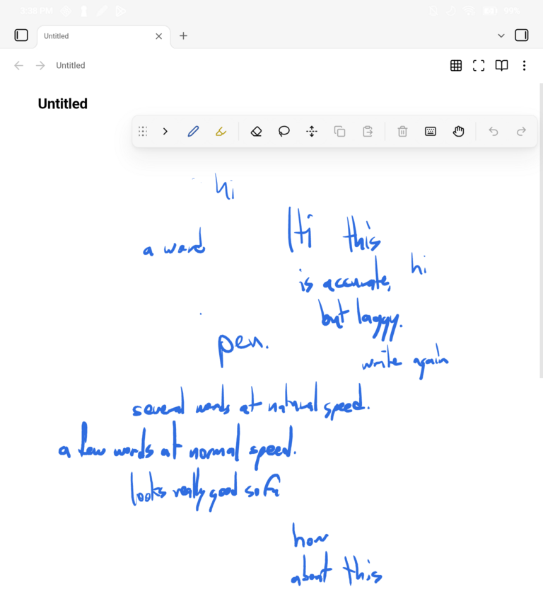
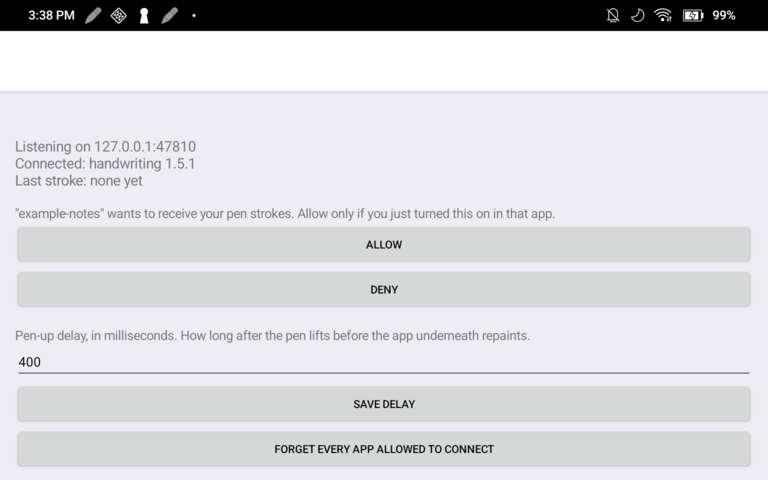

# boox-ink-bridge

Fast pen ink for note-taking plugins on Boox e-ink tablets.

A plugin running inside an Android WebView (Obsidian, for example) hears the pen late
and has no access to the tablet's fast e-ink drawing path, so handwriting lags behind
the nib. This companion app can reach that path. It draws the line in firmware as you
write, then hands each finished stroke to the plugin, which stores it as its own ink.



*Handwriting in an Obsidian note after the plugin has taken over the strokes. A
screenshot cannot show the firmware ink itself; that is drawn straight to the panel.*

## Status

Early and working, on one device.

- Tested on a Boox Note Mini C (Android 16) only.
- The only plugin that speaks the protocol so far is a development branch of
  [Handwriting](https://github.com/jdkruzr/handwriting/tree/boox-bridge) for Obsidian.
  It is not in a released version of that plugin.
- Notes and PDFs both work on that device.
- The firmware preview is a constant-width line in the pen colour selected in the
  plugin. Its width is the plugin's estimate of how heavy the stored stroke will be, so
  the weight holds at pen-up; the stored stroke still varies with pressure and the
  preview does not.
- No release builds. You build and sideload it yourself.

## How it works

1. The companion runs a foreground service with a WebSocket server on loopback
   (`127.0.0.1:47810`).
2. The plugin connects and says where its ink surface is on screen and which pen is
   selected.
3. The companion puts a transparent, untouchable overlay over that area and opens
   Onyx raw drawing on it. Finger touches pass through to the app underneath.
4. When the pen comes into range the firmware takes the screen and draws the line with
   no round trip through Android. A short time after the pen lifts, the companion gives
   the screen back so the app can repaint.
5. At pen-up the companion sends the whole stroke. The plugin places it, stores it and
   paints it, and drops its own late copy of the same contact.

The wire format is in [docs/PROTOCOL.md](docs/PROTOCOL.md). The JSON files in
`fixtures/` are shared with the plugin's tests so the two ends cannot drift apart.

## Requirements

- A Boox tablet with a pen. The app depends on Onyx's pen SDK and does nothing useful
  elsewhere.
- Android 10 or later.
- To build: JDK 17 and the Android SDK (platform 34).

## Build and install

```bash
./gradlew :app:assembleDebug
adb install -r app/build/outputs/apk/debug/app-debug.apk
```

`gradle.properties` pins `org.gradle.java.home` to a Debian/Ubuntu JDK 17 path. Change
or remove that line if your JDK lives elsewhere. Create `local.properties` with
`sdk.dir=/path/to/Android/Sdk` if Gradle cannot find the SDK.

Run the unit tests with `./gradlew :app:testDebugUnitTest`.

## Using it

1. Open **Ink Bridge** on the tablet and allow it to draw over other apps. It keeps a
   notification up while it runs.
2. In Obsidian, turn on **Boox companion** in Handwriting's settings (Developer group).
3. The first time, Ink Bridge asks whether to let the plugin receive your pen strokes.
   Allow it. You are asked once per app.
4. Write. Picking the highlighter, eraser or lasso pauses the fast ink and the plugin
   handles those tools itself.



**Pen-up delay** is how long after the pen lifts before the app underneath repaints.
Shorter shows the stored stroke sooner; longer means fewer repaints while you write.

**Preview thickness** scales the firmware line, in percent. Leave it at 100 unless the
line changes weight when the pen lifts: raise it if the writing gets heavier, lower it if
it gets lighter.

## Who can connect

The server listens on loopback, which keeps the network out but not the tablet itself:
any installed app, and any web page open in a browser on the tablet, can reach
`127.0.0.1`. A connected client receives every pen stroke, so the companion checks two
things first.

- **Origin.** Browsers state a page's origin on every WebSocket handshake and a page
  cannot forge it. Anything other than a note app's own WebView origin is refused.
- **Pairing.** Each client presents a secret it generated, and you approve it once.
  Only a hash of the secret is stored. An unapproved connection cannot displace the
  current one.

One limit: the name shown in the pairing prompt is whatever the connecting app says it
is. An app already installed on the tablet could claim another app's name. Allow a
request only when you have just turned the feature on yourself.

## Repository layout

| Path | What it is |
|---|---|
| `app/` | The companion app. |
| `docs/PROTOCOL.md` | The wire format. |
| `fixtures/` | Example messages, read by this repo's tests and the plugin's. |
| `tools/handshake.mjs` | Connects from a computer through `adb forward` and prints the reply. |

## Licence

Apache License 2.0; see [LICENSE](LICENSE).

The Onyx pen and device SDKs are proprietary binaries downloaded from Onyx's Maven
repository at build time. They are not part of this project and are not covered by its
licence; see [NOTICE](NOTICE). This project is not affiliated with or endorsed by Onyx
International.
